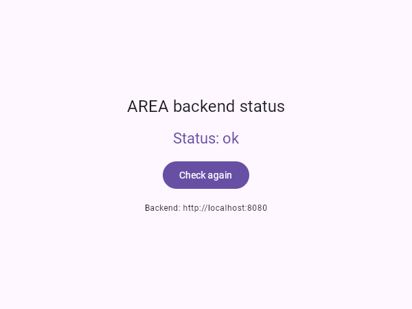
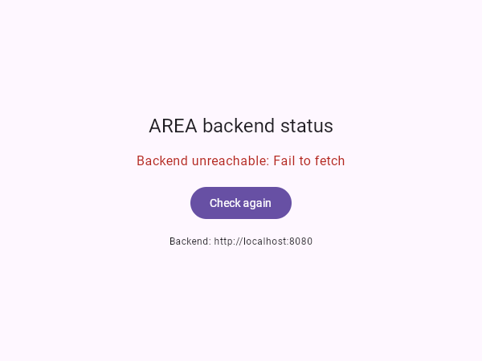
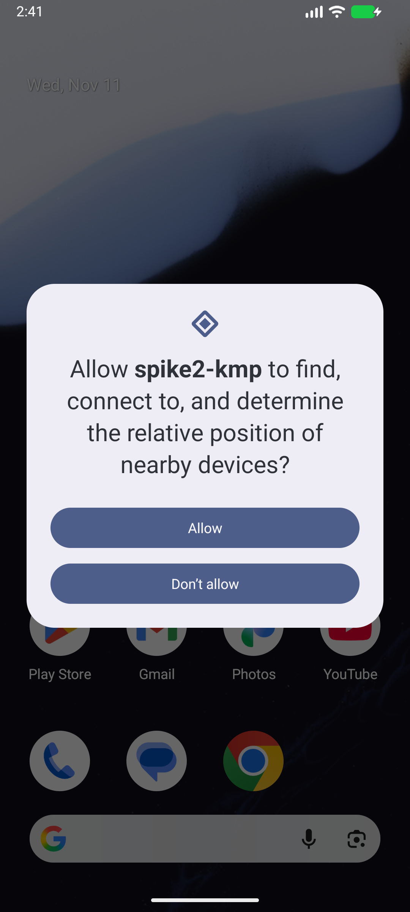
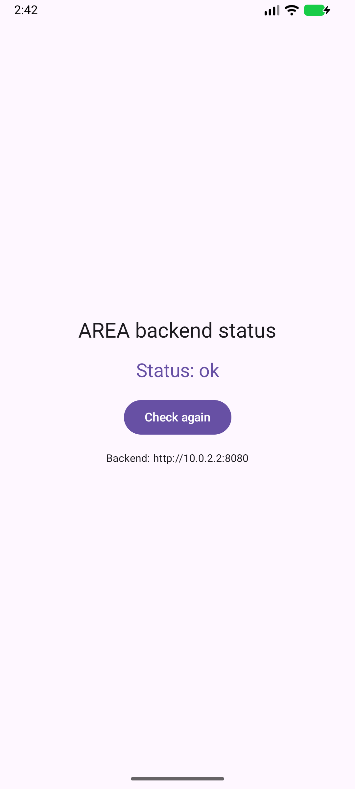

# Spike 3 notes: Kotlin Multiplatform + Compose (web + Android)

**Code:** this directory — a KMP/Compose project colocated with these notes

## Timebox

**3 hours, agreed by the whole team before any code was written — the full target was reached inside it, on both platforms.** Gradle setup (version catalog, plugins, targets, source sets) consumed the largest share of the box. When the timer rang, the web app and the Android app were both running against the backend on `:8080`, and the 4 shared MockEngine tests passed. The remaining minutes went into the screenshots and the accessibility attributes (`heading()`, `liveRegion`).

| Web, backend up | Web, backend down | Android permission prompt | Android, backend up |
|---|---|---|---|
|  |  |  |  |

## What was built

Starting point: the KMP wizard (kmp.jetbrains.com).

| Module / file | Role |
|---|---|
| `gradle/libs.versions.toml` | Versions in one place: Kotlin 2.4.21, Compose Multiplatform 1.12.2, AGP 9.1.1 (from the wizard), **+ Ktor 3.6.1**, coroutines 1.11.0, serialization plugin |
| **`shared/`** | Code shared by every platform. Targets: `android` + `wasmJs` |
| `shared/src/commonMain/.../App.kt` | Root of the UI, identical on web and Android |
| `.../PingScreen.kt` | The screen: heading, status (loading / ok / error), "Check again" button. Accessibility: `heading()` + `liveRegion` so screen readers announce status changes. |
| `.../PingUiState.kt` | `Loading` / `Success` / `Error`, plus `loadPingState()`, which turns the API call into a state (testable without UI) |
| `.../PingApi.kt` | Ktor `HttpClient`: JSON, 5 s timeout, non-2xx = error |
| `.../PingResponse.kt` | `@Serializable data class PingResponse(val status: String)` |
| `.../BackendUrl.kt` + `androidMain/BackendUrl.android.kt` + `wasmJsMain/BackendUrl.wasmJs.kt` | `expect`/`actual`: backend is `http://10.0.2.2:8080` on Android (emulator → Mac) and `http://localhost:8080` on web |
| `shared/src/commonTest/.../PingApiTest.kt` | 4 tests with Ktor's **MockEngine** (fake backend): ok, 503, connection failure, malformed JSON |
| **`webApp/`** | Web entry point: `main.kt` (`ComposeViewport` → `App()`), `index.html`, dev server on **port 8081** (8080 is the backend's port) |
| **`androidApp/`** | Android entry point: `MainActivity` (asks for the local-network permission, then shows `App()`), manifest (`INTERNET` + `ACCESS_LOCAL_NETWORK`), `res/xml/network_security_config.xml` (plain `http://` allowed **only** to `10.0.2.2`) |

## How to run it

```sh
# 1. backend (spike 1) in another terminal
cd spikes/2/java-spring && PORT=8080 ./gradlew bootRun

# 2a. web: opens http://localhost:8081 and reloads on changes
cd spikes/2/kmp && ./gradlew :webApp:wasmJsBrowserDevelopmentRun

# 2b. Android: start the emulator (Android Studio → Device Manager), then
cd spikes/2/kmp && ./gradlew :androidApp:installDebug
#     open "spike2-kmp" on the emulator and tap Allow on the permission prompt

# tests (shared code, run on the JVM, no server needed)
cd spikes/2/kmp && ./gradlew :shared:testAndroidHostTest
```

`local.properties` (not committed) points Gradle to the Android SDK. If it's missing, Gradle uses `ANDROID_HOME`.

## Observations

- **Cross-platform / single codebase:** strong. The UI, state, networking and JSON are 100% in `commonMain`. Per-platform code is tiny: the backend URL (2 lines each), the HTTP engine (1 dependency each), and the entry points (`MainActivity`, `main.kt`).
- **Platforms leak through:** the error type differs in the browser (bug 1), and Android needs its own permissions and network config (bug 2). "Write once" holds for the code, not for the debugging.
- **Developer velocity:** the shared Compose code is quick to write. Gradle setup is the slow, error-prone part (plugins, targets, source sets, version catalog), and the first build downloads a lot.
- **Performance / size:** the web bundle is **~11.5 MB** (Wasm) for one screen, which is heavy for a first page load. It needs a modern browser with WasmGC support.
- **Accessibility (web):** Compose draws everything on a **canvas**. Semantics like `heading()` and `liveRegion` exist, but how well screen readers and keyboard navigation work on the web canvas **wasn't tested**.
- **Ecosystem maturity:** Android target mature. Web (Wasm) target works but is younger, with fewer examples and more "experimental" opt-ins (`@OptIn(ExperimentalWasmDsl::class)`, `ExperimentalComposeUiApi`).
